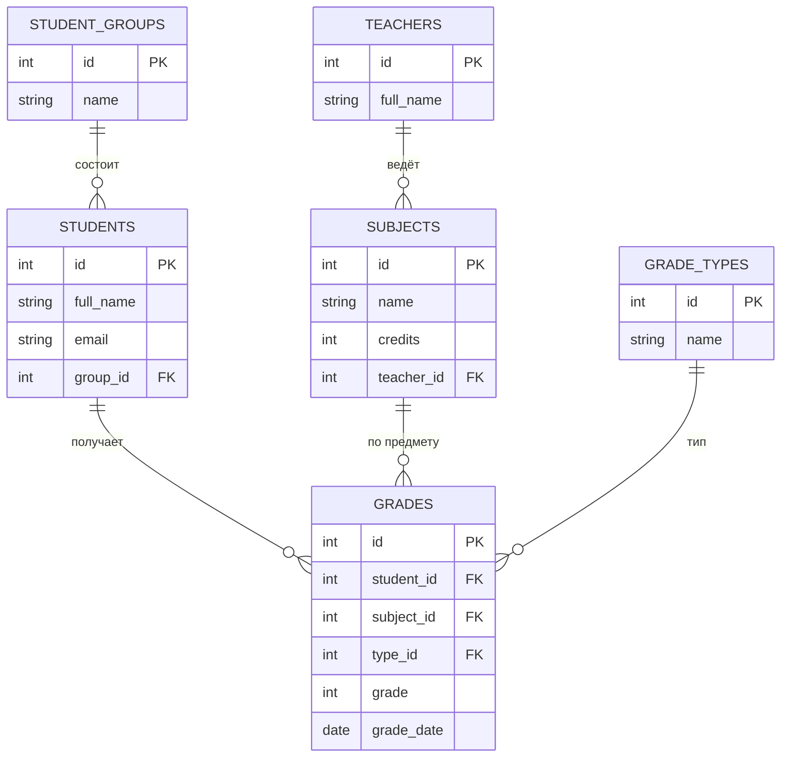
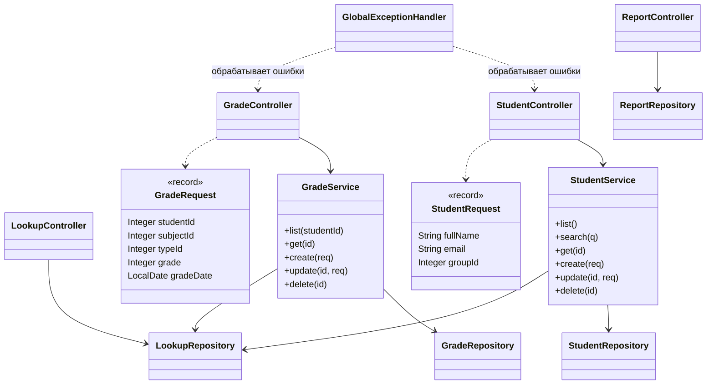

# Учёт студентов и оценок (REST API + Swagger)

Курсовой проект: Spring Boot 3, Java 17, H2 (in-memory), JdbcTemplate, springdoc-openapi (Swagger UI).

## Запуск

### Через Docker
```
docker compose up --build spring-app
```

### Через Maven (без Docker)
```
mvn spring-boot:run
```

После старта:
- Swagger UI: http://localhost:8000/swagger-ui.html
- OpenAPI JSON: http://localhost:8000/v3/api-docs

База H2 создаётся в памяти из `schema.sql` и заполняется тестовыми данными из `data.sql` при каждом запуске.

## Эндпоинты

| Метод | URL | Описание |
|---|---|---|
| GET | `/api/students` | список студентов |
| GET | `/api/students/{id}` | студент по id |
| GET | `/api/students/search?q=` | поиск по имени, email, группе |
| POST | `/api/students` | добавить студента |
| PUT | `/api/students/{id}` | изменить студента |
| DELETE | `/api/students/{id}` | удалить студента (оценки каскадом) |
| GET | `/api/grades?studentId=` | список оценок (фильтр по студенту необязателен) |
| GET | `/api/grades/{id}` | оценка по id |
| POST | `/api/grades` | добавить оценку |
| PUT | `/api/grades/{id}` | изменить оценку |
| DELETE | `/api/grades/{id}` | удалить оценку |
| GET | `/api/groups`, `/api/subjects`, `/api/grade-types` | справочники |
| GET | `/api/reports/averages` | средний балл по студентам и предметам |
| GET | `/api/reports/debtors?threshold=50` | студенты со средним баллом ниже порога |

### Примеры тела запроса

`POST /api/students`
```json
{ "fullName": "Иванов Иван", "email": "ivanov@alatoo.edu.kg", "groupId": 1 }
```

`POST /api/grades`
```json
{ "studentId": 1, "subjectId": 1, "typeId": 1, "grade": 95, "gradeDate": "2026-11-10" }
```

## Валидация
- имя и email не пустые, email в правильном формате
- оценка от 0 до 100, дата в формате `yyyy-MM-dd`
- группа, студент, предмет и тип оценки должны существовать (иначе 400)
- email уникален (иначе 409)
- несуществующий id при чтении, изменении, удалении: 404

Ошибки возвращаются в JSON: `{ "status": 400, "error": "...", "details": { ... } }`.

## Нормализация (3NF)
Группа, преподаватель, предмет и тип оценки вынесены в отдельные таблицы. В `grades` хранятся только внешние ключи и сама оценка, поэтому нет повторяющихся данных и транзитивных зависимостей.

## ER-диаграмма



## Class diagram


